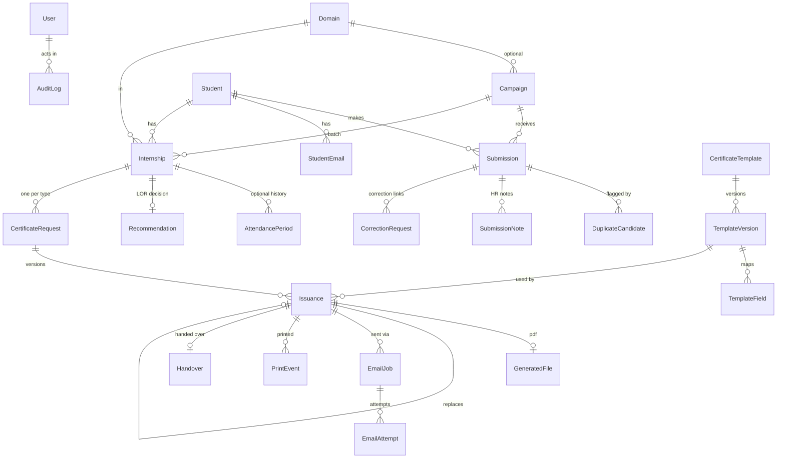

# Data model

## Rules enforced by the database

| Rule | Constraint |
|---|---|
| Domain names unique ignoring case/whitespace | `Domain.normalized_key` unique |
| Campaign closes after it opens | `campaign_closes_after_opens` |
| One submission per student per campaign | `one_submission_per_student_per_campaign` |
| Same registration number cannot be submitted twice in one campaign | `one_submission_per_reg_no_per_campaign` (on `Submission.reg_no_key`) |
| Double-submitted forms collapse to one row | `Submission.idempotency_key` unique |
| Internship/attendance end ≥ start | `internship_end_after_start`, `attendance_to_after_from` |
| One request per certificate type per internship | `one_request_per_type_per_internship` |
| One active template version per type | partial unique `one_active_version_per_template` |
| Active template must have an approver | `active_version_requires_approval` |
| One live (draft or issued) issuance per request | partial unique `one_live_issuance_per_request` |
| "Issued" only with a generated PDF and issue date | `issued_requires_generated_pdf` |
| Reissue must state a reason | `reissue_requires_reason` |
| One in-flight email per issuance + recipient | partial unique `one_inflight_email_per_recipient` |
| Each email job sent at most once per key | `EmailJob.idempotency_key` unique |
| Rejected / correction-requested submissions have a reason; decisions have a reviewer | `rejection_or_correction_requires_reason`, `decision_requires_reviewer` |
| Duplicate decisions have a reviewer and reason | `duplicate_decision_has_reviewer_and_reason` |
| One open correction request per submission; correction has a reason | `one_open_correction_per_submission`, `correction_requires_reason` |
| Completion / project / recommendation decisions have a reviewer; negative ones a note | `completion_decision_has_reviewer`, `not_completed_requires_note`, `project_decision_has_reviewer`, `rejected_project_requires_note`, `verified_project_has_title`, `recommendation_decision_has_reviewer`, `recommended_requires_feedback_and_evaluation` |
| Certificate decisions have a reviewer; rejections a reason | `certificate_decision_has_reviewer`, `certificate_rejection_requires_reason` |
| Audit log is append-only | model + queryset guards; PostgreSQL trigger |
| Referenced history is never cascade-deleted | `on_delete=PROTECT` throughout |

Registration numbers are *not* unique: `Student.reg_no_key` (case/separator-insensitive) is indexed and used
only to flag `DuplicateCandidate` rows for HR review.

## Production gate

A certificate can be issued as production only when **all** are true:

1. `TemplateVersion.is_production` — the file is an official Gradtwin template (test templates are always `False`).
2. `TemplateVersion.status == active` — which requires a Super Admin approval record.
3. `CERT_PRODUCTION_ISSUANCE_ENABLED=true` in the environment.
